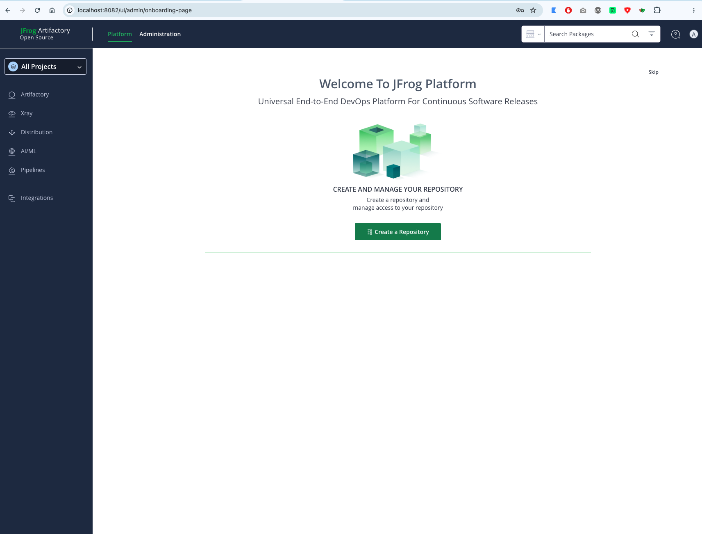

# 03 - Exploring the Artifactory Interface

Now that Artifactory is running, let's have a look around.

## The Dashboard

After logging in, we're presented with the JFrog web interface.

*The Artifactory dashboard running locally.*

There are a few main areas worth getting familiar with:

| Section | What it does |
|---|---|
| Home | General overview of the JFrog platform |
| Artifacts | Browse stored files and packages |
| Administration | Manage repositories and settings |
| Search | Find artifacts stored in repositories |

The available options may vary depending on the Artifactory version and user permissions.

## Why Is This Useful for QA?

As QA engineers, we're most likely to use Artifactory to find and download application builds.

For example, if we need to test an older version of an application or reproduce a defect, we may need to locate a specific artifact.

We'll look at how to do this in the next few sections.

## Next

[04 - Understanding Repositories](04-repository-types.md)
