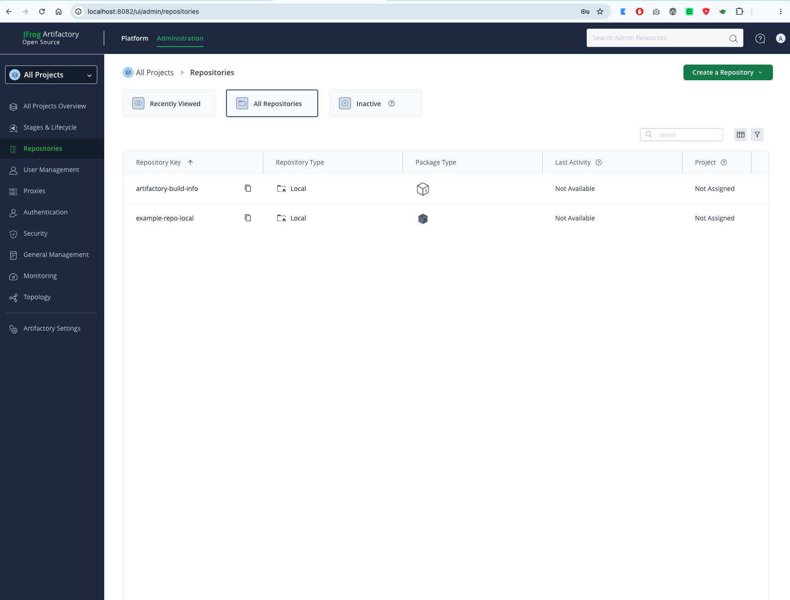

# 04 - Understanding Repositories

## What is a Repository?

In Artifactory, a **repository** is a place where software artifacts are stored, organised or made available for download.

Think of it as a central location where teams can find the files they need, rather than keeping different versions scattered across local machines or shared drives.

Repositories are commonly used to:

- Store application builds and release packages.
- Keep different versions of software.
- Share libraries and dependencies between teams.
- Make artifacts available to CI/CD pipelines.
- Retrieve older builds for testing or troubleshooting.

For example, a repository containing application builds might look like this:

```text
application-builds/
├── application-1.0.zip
├── application-1.1.zip
└── application-1.2.zip
```

As QA engineers, this is useful when we need to find a particular build for testing or reproduce an issue against an older version.

## The Three Repository Types

Artifactory has three main repository types: **Local, Remote and Virtual**.

Although they're all called repositories, they serve different purposes.

| Type | What it does | Common uses |
|---|---|---|
| **Local** | Stores artifacts directly in Artifactory | Application builds, internal libraries and releases |
| **Remote** | Connects to external repositories and caches downloaded artifacts | Maven Central, third-party libraries and dependencies |
| **Virtual** | Groups repositories together behind a single URL | Simplifying dependency management for developers and CI/CD pipelines |

### 1. Local Repositories

A **local repository** stores artifacts uploaded by developers, build pipelines or other teams.

For example, when a developer builds a new application version, the resulting file can be uploaded to a local repository.

```text
qa-test-builds/
├── sample-app-1.0.zip
├── sample-app-1.1.zip
└── sample-app-1.2.zip
```

**When would we use one?**

- Storing application builds.
- Keeping previous versions of software.
- Sharing internal libraries.
- Making specific builds available for testing.

**QA example:** A defect is reported against application version `1.1`. We can download that exact version from the local repository to reproduce the issue.

### 2. Remote Repositories

A **remote repository** connects Artifactory to an external repository, such as Maven Central.

Instead of downloading packages directly from the internet, developers and build tools can request them through Artifactory.

Artifactory can cache these packages so they don't need to be downloaded from the external source every time.

**When would we use one?**

- Accessing third-party libraries.
- Downloading dependencies for applications.
- Retrieving packages used by automation frameworks.
- Reducing repeated downloads from public repositories.

**QA example:** A Selenium automation project needs Java dependencies. A remote Maven repository allows Maven to retrieve those dependencies through Artifactory.

### 3. Virtual Repositories

A **virtual repository** combines multiple repositories behind a single URL.

It doesn't normally store artifacts itself. Instead, it provides access to the repositories included within it.

For example:

```text
          QA Automation Project
                   |
                   v
              maven-virtual
                   |
          +--------+--------+
          |                 |
          v                 v
     maven-local       maven-remote
          |                 |
          v                 v
   Internal Libraries   Maven Central
```

**When would we use one?**

- Combining internal and external dependencies.
- Providing a single repository URL for build tools.
- Simplifying Maven or Gradle configuration.
- Making dependency management easier for CI/CD pipelines.

**QA example:** An automation project uses an internal testing library alongside external dependencies such as Selenium and JUnit. A virtual repository allows Maven to retrieve both through one URL.

## Finding Repositories in Artifactory

Repositories can be viewed and managed through the Administration section of Artifactory.



*Repository management in Artifactory.*

## Summary

The easiest way to remember the three types:

- **Local:** Stores our own artifacts.
- **Remote:** Provides access to external artifacts.
- **Virtual:** Provides one URL for accessing multiple repositories.

For QA, understanding these differences helps us know where application builds are stored, how automation projects retrieve dependencies and how artifacts move through development and testing workflows.

## Next

[05 - Creating a Repository](05-creating-repositories.md)
