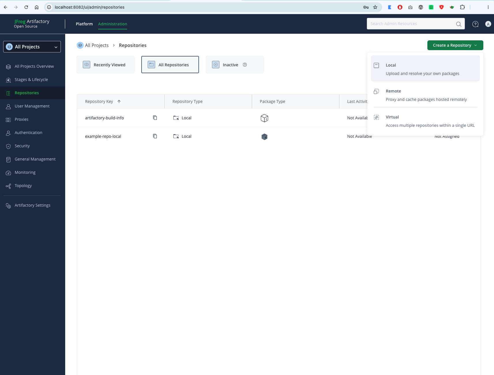

# 05 - Creating a Repository

Now that we've looked at the different repository types, let's create one.

For this exercise, we're going to create a **Generic Local Repository** to store some sample application builds.

## Creating the Repository

In Artifactory, navigate to:

**Administration → Repositories → Create a Repository**

Select **Local Repository**.



*Selecting the repository type.*

## Choosing a Package Type

Artifactory supports different package types, including Maven, Gradle and Generic.

For this example, we're using **Generic**.

Generic repositories allow us to store different types of files without needing to follow a particular package format.

This makes them useful for storing things like ZIP archives, application builds and other files used during testing.

## Repository Configuration

Enter the following details:

| Setting | Value |
|---|---|
| Repository Key | `qa-test-builds` |
| Package Type | Generic |
| Description | Sample application builds for QA testing |

Leave the remaining settings at their defaults.


*Configuring our new local repository.*

Save the repository.

## Checking the Repository

Once created, open the **Artifacts** section of Artifactory.

You should now see `qa-test-builds` listed.


*Our new repository, ready to store artifacts.*

## Why Is This Useful for QA?

A local repository can be used to keep different versions of an application available for testing.

For example:

```text
qa-test-builds/
├── sample-app-1.0.zip
├── sample-app-1.1.zip
└── sample-app-1.2.zip
```

If QA needs to investigate a defect in version `1.1`, they can retrieve that particular build rather than relying on someone to provide it manually.

## Next

[06 - Managing Artifacts](06-managing-artifacts.md)
