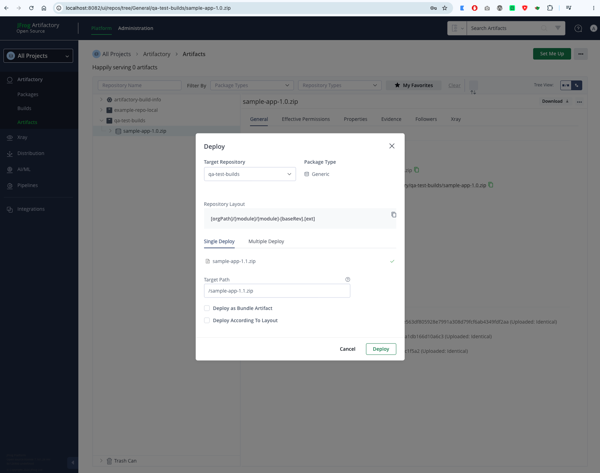
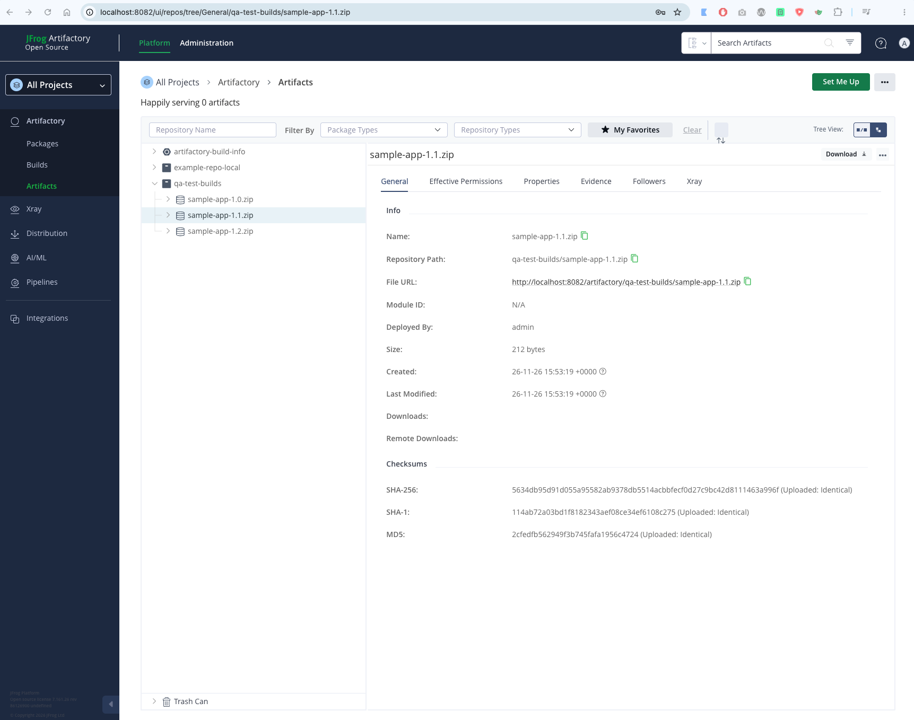

# 06 - Managing Artifacts

Now that we've created a repository, let's look at how to upload, view and download artifacts.

For this exercise, we're using our `qa-test-builds` repository to store different versions of a sample application.

## Creating Sample Artifacts

First, we created three ZIP files to represent different application versions.

Using Terminal:

```bash
mkdir -p ~/jfrog-learning/sample-builds
cd ~/jfrog-learning/sample-builds
```

We then created the files:

```bash
echo "Sample Application - Version 1.0" > application.txt
zip sample-app-1.0.zip application.txt

echo "Sample Application - Version 1.1" > application.txt
zip sample-app-1.1.zip application.txt

echo "Sample Application - Version 1.2" > application.txt
zip sample-app-1.2.zip application.txt
```

Each ZIP contains a text file identifying its version.

These aren't real applications, but they give us something to work with.

## Uploading Artifacts

In Artifactory, navigate to:

**Platform → Artifactory → Artifacts**

Select the `qa-test-builds` repository and use the **Deploy/Upload** option.



*Uploading a sample application build to Artifactory.*

Upload the three ZIP files.

Once uploaded, the repository should contain:

```text
qa-test-builds/
├── sample-app-1.0.zip
├── sample-app-1.1.zip
└── sample-app-1.2.zip
```


*Three versions of our sample application stored in Artifactory.*

## Viewing Artifact Details

Selecting an artifact allows us to view information about the file.

This can include its size, creation date and checksums.



*Viewing the details of sample-app-1.1.zip.*

### What is a checksum?

A checksum is a value calculated from a file's contents.

Artifactory records checksums such as SHA-256, which can be used to check whether two files are identical.

This is useful when verifying that the application build being deployed is the same one that QA tested.

## Downloading Artifacts

We can download a specific version by selecting the artifact and choosing **Download**.

For example, download `sample-app-1.1.zip`.

Once downloaded, we can inspect its contents using Terminal:

```bash
unzip -p sample-app-1.1.zip application.txt
```

The output should be:

```text
Sample Application - Version 1.1
```

We can do the same with version `1.0`:

```bash
unzip -p sample-app-1.0.zip application.txt
```

This returns:

```text
Sample Application - Version 1.0
```

## Why Is This Useful for QA?

Having access to different application versions is useful when testing releases or investigating defects.

For example, if a bug is reported in version `1.1`, we can retrieve that exact build rather than relying on someone to send us a copy.

We can also compare it with an earlier version to help understand when an issue was introduced.

In a real project, these artifacts would usually be created and uploaded automatically by a CI/CD pipeline.

## Next

[07 - Artifactory for QA](07-artifactory-for-qa.md)
